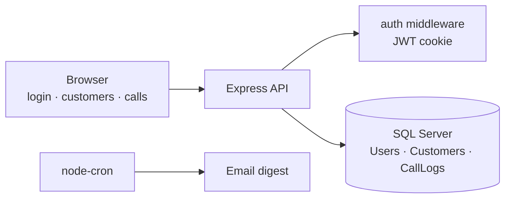

# CRM — Customer Registry

     

A login-protected web app for a sales team: customers, contact history and call logs in Microsoft SQL Server.

## Features
- Customers with search and filters; per-customer **call log**
- Login with **JWT stored in an httpOnly cookie**, bcrypt passwords, **rate-limited** auth endpoint
- CLI script to create the first admin and new users
- Scheduled jobs (node-cron) with email notifications
- CSV import of existing customer lists
- Runs against local SQL Server, Docker or Azure SQL

---

> **Showcase repository.** This repo presents the project — what it does, how it is built and what it looks like.
> The full source code is private. For a walkthrough or a code sample, get in touch.

**Tural Zamanlı** · Data & Automation Developer · [Portfolio](https://dicapso.github.io) · [GitHub](https://github.com/Dicapso)
